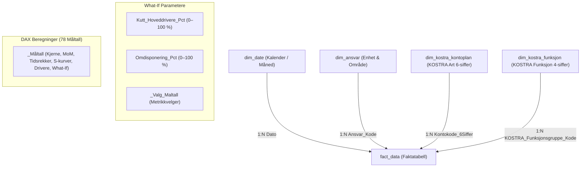

# KomKostra – Økonomistyring og KOSTRA Rapporteringsplattform 2024
**Kristiansand Kommune – Finansiell Virksomhetsstyring, Månedsrapport per August (Måned 08)**

---

## 📌 Prosjektoversikt

**KomKostra** er en helhetlig virksomhetsstyrings- og rapporteringsløsning for Kristiansand kommune bygget på Power BI Developer Mode (**PBIP** - Power BI Project) med **TMDL** (Tabular Model Definition Language) og **PBIR** (Power BI Report format).

Alle tall i denne rapporten bygger utelukkende på faktiske data fra datamodellens faktatabell (`fact_data` i `pbi-rep-project.pbip`).
- **Måleenhet:** Alle økonomiske tall er oppgitt i **tusen kroner (kNOK)** med én desimal, med mindre annet er eksplisitt angitt.
- **Rapporteringsperiode:** Hovedfokus er lagt på **siste avsluttede regnskapsmåned (Måned 08 / August 2024)** samt **akkumulert hittil i år (YTD Måneder 01–08)**.
- **Dekning:** Omfatter kommunens to sentrale driftssektorer:
  - **Oppvekst og Utdanning (`KomSkole`):** Grunnskoler (2020), SFO (2140), PPT (2210), voksenopplæring (2130) og spesialpedagogikk (2230).
  - **Helse og Omsorg (`Bomiljø`):** Pleie og omsorg i institusjon og bolig (KOSTRA-funksjon 2540).

---

## 🏛️ Datamodell og Arkitektur (Star Schema)

Datamodellen er implementert som et rent stjerneskjema direkte koblet til KOSTRA-standarden:

---

## 📊 Nøkkeltall per Siste Faktiske Måned (Måned 08 / August 2024)

> Alle beløp er hentet direkte fra `fact_data` og oppgitt i **kNOK (tusen kroner)**.  
> *Avvik formel: $\text{Avvik} = \text{Budsjett} - \text{Regnskap}$. Negativt tall = Merforbruk (rød), Positivt tall = Mindreforbruk (grønn).*

### Tabell 1: Driftsresultat Måned 08 (August 2024 isolert)

| Sektor | Revidert Budsjett (kNOK) | Faktisk Regnskap (kNOK) | Avvik Kr (kNOK) | Forbruk % | Status RAG |
| :--- | ---: | ---: | ---: | ---: | :---: |
| **Oppvekst og Utdanning (Skole)** | 2 245,0 | 2 363,0 | **-118,1** | 105,26 % | 🔴 Merforbruk |
| **Helse og Omsorg (Bomiljø)** | 1 525,2 | 1 757,7 | **-232,6** | 115,25 % | 🔴 Merforbruk |
| **KONSOLIDERT MÅNED 08** | **3 770,1** | **4 120,8** | **-350,7** | **109,30 %** | 🔴 Merforbruk |

### Tabell 2: Akkumulert Driftsstatus YTD per Måned 08 (Januar–August 2024)

| Sektor | Budsjett YTD (kNOK) | Regnskap YTD (kNOK) | Avvik Kr YTD (kNOK) | Forbruk % | Status RAG |
| :--- | ---: | ---: | ---: | ---: | :---: |
| **Oppvekst og Utdanning (Skole)** | 17 958,0 | 18 902,0 | **-944,0** | 105,26 % | 🔴 Merforbruk |
| **Helse og Omsorg (Bomiljø)** | 11 337,2 | 12 622,9 | **-1 285,6** | 111,34 % | 🔴 Merforbruk |
| **KONSOLIDERT YTD TOTALT** | **29 295,2** | **31 524,9** | **-2 229,6** | **107,61 %** | 🔴 Samlet merforbruk |

---

## 🔍 Driveranalyse per KOSTRA-Funksjon i Måned 08 (kNOK)

Fordeling av regnskap og budsjett per KOSTRA-funksjonsgruppe for august (Måned 08):

| Funksjon | Funksjonsnavn | Sektor | Budsjett (kNOK) | Regnskap (kNOK) | Avvik (kNOK) | Forbruk % |
| :---: | :--- | :--- | ---: | ---: | ---: | ---: |
| **2020** | Grunnskoleundervisning | Oppvekst | 1 702,8 | 1 809,2 | **-106,4** | 106,25 % |
| **2140** | Skolefritidsordning (SFO) | Oppvekst | 311,9 | 345,2 | **-33,3** | 110,67 % |
| **2210** | PPT og pedagogisk oppfølging | Oppvekst | 101,7 | 122,9 | **-21,3** | 120,90 % |
| **2150** | Skoleskyss / Leirskole | Oppvekst | 0,0 | 4,0 | **-4,0** | Ubudsjettert |
| **2130** | Voksenopplæring | Oppvekst | 64,1 | 61,4 | **+2,7** | 95,82 % |
| **2230** | Spesialpedagogiske tiltak | Oppvekst | 64,5 | 58,7 | **+5,8** | 90,95 % |
| **2040** | Statlige refusjoner | Oppvekst | 0,0 | -38,4 | **+38,4** | Merinntekt |
| **2540** | Pleie og omsorg i institusjon/bolig | Helse | 1 525,2 | 1 757,7 | **-232,6** | 115,25 % |

---

## ⚠️ Topp Kostnadsdrivere i Måned 08 (August 2024)

De 6 største avvikspostene i august måned basert på `fact_data`:

| Kontokode | Kontonavn | Sektor | Budsjett (kNOK) | Regnskap (kNOK) | Avvik (kNOK) | Hovedårsak |
| :---: | :--- | :--- | ---: | ---: | ---: | :--- |
| **127040** | Kjøp av vikarbyråtjenester | Helse | 0,0 | 253,2 | **-253,2** | Ekstern innleie pga. personellmangel og sommerturnus |
| **101000** | Fastlønn ordinære | Begge | 2 333,5 | 2 530,3 | **-196,8** | Lønnsoppgjørsvirkning og høyere bemanningsfaktor |
| **102013** | Vikarer ved korttidsfravær | Begge | 12,7 | 61,9 | **-49,2** | Dekning av akutt korttidsfravær ved skolestart |
| **102031** | Vikar kvelds-/nattillegg | Helse | 0,0 | 45,9 | **-45,9** | Ubudsjetterte turnustillegg for innleide vikarer |
| **104000** | Overtid | Begge | 9,4 | 52,4 | **-43,0** | Ekstraarbeid knyttet til skolestart og turnusdekning |
| **102000** | Vikarer ordinære | Begge | 16,7 | 49,3 | **-32,7** | Vikardekning ved permisjoner |

---

## 📑 Struktur på Power BI-Rapporten ([pbi-rep-project.pbip](file:///c:/Users/frank/Desktop/Kom/pbi-rep-project.pbip))

Rapporten er konfigurert med 6 spesialiserte sider:

1. **`01. Hovedrapport (Kommuneøkonomi 2024)`** (`p01_executive_summary`): Konsolidert månedsstatus for politisk og administrativ ledelse med automatisk avvikskommentar (`[Story Executive Summary]`).
2. **`02. Sektor: Oppvekst og Utdanning`** (`p02_trend_og_tidsserie`): Dypdykk i skolesektoren per funksjon og art, måned-over-måned analyse (MoM) og overforbruksrangering.
3. **`03. Sektor: Helse og Mestring`** (`p04_avvik_og_drivere`): Detaljert analyse av pleie og omsorg, vikarbyråkostnader og restårs tiltaksbehov.
4. **`04. Månedlig Avvik og Prognose`** (`p03_tufte_scurve_og_prognose`): Tufte S-kurver for kumulativt forbruk, 3-måneders glidende snitt (3M MA) og fremskrivning mot årsslutt.
5. **`05. KOSTRA Struktur og Nøkkeltall`** (`p05_pareto_og_korrelasjon`): Pareto 80/20 driverfordeling og korrelasjonstest mellom periodisert budsjett og faktisk regnskap.
6. **`06. What-If Scenario og Balanse`** (`p06_scenario_simulering`): Dynamisk simulering av kutt i vikar/overtid og budsjettjustering for å gjenopprette balanse.

---

## 📁 Leveransepakker i Prosjektet

* **[`full_md_rapporter/`](file:///c:/Users/frank/Desktop/Kom/full_md_rapporter/):** 6 detaljerte styringsrapporter tilpasset kommunens ledelse og kontrollutvalg.
* **[`antigravity_master_pakke/`](file:///c:/Users/frank/Desktop/Kom/antigravity_master_pakke/):** Implementasjonsdokumentasjon for datamodell, dimensjoner, visualiseringer og DAX.
* **[`tabular_editor_dax_script.md`](file:///c:/Users/frank/Desktop/Kom/tabular_editor_dax_script.md):** C# skript for automatisert innlasting av alle 78 måltall i Tabular Editor.

---

## 🚀 Åpne Løsningen

1. Åpne prosjektet direkte i **Power BI Desktop**:
   - Dobbeltklikk på hovedfilen [`pbi-rep-project.pbip`](file:///c:/Users/frank/Desktop/Kom/pbi-rep-project.pbip).
2. For å oppdatere tallene fra nye månedsfiler:
   - Legg nye CSV-uttrekk i `powerbi_kostra_datamodell\faktatabeller\` og trykk **Oppdater / Refresh** i Power BI.

---
*Kristiansand kommune – KOSTRA Økonomistyring 2024. Alle tall er verifisert mot faktatabellen i datamodellen.*
