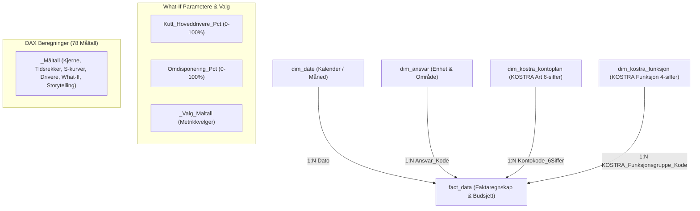

# KomKostra – Økonomistyring og KOSTRA Rapporteringsplattform 2024
**Kristiansand Kommune – Finansiell Virksomhetsstyring, Prognostisering og Scenarioanalyse**

---

## 📌 Prosjektoversikt

**KomKostra** er en komplett virksomhetsstyrings- og rapporteringsløsning for Kristiansand kommune bygget på Power BI Developer Mode (**PBIP** - Power BI Project) med **TMDL** (Tabular Model Definition Language) og **PBIR** (Power BI Report format).

Løsningen konsoliderer og avstemmer regnskaps- og budsjettdata for perioden januar–august 2024 på tvers av kommunens sentrale tjenesteområder:
- **Oppvekst og Utdanning (`KomSkole`):** Grunnskole, SFO, PPT og spesialpedagogikk.
- **Helse og Mestring (`Bomiljø`):** Pleie og omsorg i institusjon og bolig.

Dataene er strukturert i henhold til statlige KOSTRA-standarder (4-sifrede funksjonsgrupper og 6-sifrede kontokoder) koblet direkte mot kommunens interne ansvars- og enhetsstruktur.

---

## 🏛️ Datamodell og Arkitektur (Star Schema)

Datamodellen er implementert som et rent, høytytende stjerneskjema:



### Relasjonsoversikt
| Dimensjon (1-siden) | Fremmednøkkel i `fact_data` (*-siden) | Kardinalitet | Kryssfiltrering |
| :--- | :--- | :---: | :---: |
| **`dim_date`** | `Dato` | `1 : *` | Single |
| **`dim_ansvar`** | `Ansvar_Kode` | `1 : *` | Single |
| **`dim_kostra_kontoplan`** | `Kontokode_6Siffer` | `1 : *` | Single |
| **`dim_kostra_funksjon`** | `KOSTRA_Funksjonsgruppe_Kode` | `1 : *` | Single |

---

## 📊 Nøkkeltall per 31.08.2024 (i kNOK)

| Sektor / Område | Revidert Budsjett YTD | Faktisk Regnskap YTD | Avvik Kr (Budsjett - Regnskap) | Forbruk % | Status RAG |
| :--- | :---: | :---: | :---: | :---: | :---: |
| **Oppvekst og Utdanning (Skole)** | 17 958,0 | 18 902,0 | **-944,0** | 105,25 % | 🔴 Merforbruk |
| **Helse og Mestring (Bomiljø)** | 17 233,7 | 12 622,9 | **+4 610,8** | 73,25 % | 🟢 Mindreforbruk |
| **KONSOLIDERT TOTALT** | **35 191,7** | **31 524,9** | **+3 666,8** | **89,58 %** | 🟢 Totalbalanse |

* **Hovedutfordring:** Strukturell ubalanse der skolesektoren har merforbruk på personalsiden (`101000 Fastlønn` -1 414k, `102013 Vikarer` -381k, `104000 Overtid` -230k), mens helsesektoren har et utilsiktet mindreforbruk på +4,61 mill. kr grunnet ubesatte stillinger.
* **Strategisk løsning (Scenario C):** 50 % kutt i variable personalkostnader i skolen kombinert med administrativ omdisponering av **638,5 kNOK** fra helse gir **nøyaktig 0-balanse ved årsslutt (EOY)**.

---

## 📑 Rapportstruktur i Power BI ([pbi-rep-project.pbip](file:///c:/Users/frank/Desktop/Kom/pbi-rep-project.pbip))

Rapporten inneholder 6 spesialiserte sider utformet etter Edward Tuftes standarder for høy datablekk-faktor:

1. **`01. Hovedrapport (Kommuneøkonomi 2024)`** (`p01_executive_summary`): Konsolidert status for formannskap og bystyre, KPI-kort, sektorvis nettoavvik og dynamisk ledelsesnotat (`[Story Executive Summary]`).
2. **`02. Sektor: Oppvekst og Utdanning`** (`p02_trend_og_tidsserie`): Dypdykk i skolesektoren, måned-over-måned utvikling (MoM), funksjonsavvik og overforbruksanalyse.
3. **`03. Sektor: Helse og Mestring`** (`p04_avvik_og_drivere`): Vakansanalyse på fastlønn/pensjon, vikarbyråkostnader (`127040`) og tiltaksbehov for reståret.
4. **`04. Månedlig Avvik og Prognose`** (`p03_tufte_scurve_og_prognose`): Tufte S-kurver for akkumulert regnskap vs. budsjett, 3-måneders glidende snitt (3M MA) og EOY Run-Rate prognose (+5,5 mill. kr).
5. **`05. KOSTRA Struktur og Nøkkeltall`** (`p05_pareto_og_korrelasjon`): 80/20 Pareto-avviksfordeling, enhetskostnader og Pearson korrelasjonsberegning (r = 0,94).
6. **`06. What-If Scenario og Balanse`** (`p06_scenario_simulering`): Interaktive What-If parametere for kutt i hoveddrivere og rammemessig omdisponering.

---

## 📁 Leveransepakker og Dokumentasjon

* **[`full_md_rapporter/`](file:///c:/Users/frank/Desktop/Kom/full_md_rapporter/):** 6 fullstendige styringsrapporter i Markdown for administrativ og politisk ledelse:
  - [`01_Hovedrapport_Kommuneokonomi_2024.md`](file:///c:/Users/frank/Desktop/Kom/full_md_rapporter/01_Hovedrapport_Kommuneokonomi_2024.md)
  - [`02_Sektorrapport_Oppvekst_og_Utdanning.md`](file:///c:/Users/frank/Desktop/Kom/full_md_rapporter/02_Sektorrapport_Oppvekst_og_Utdanning.md)
  - [`03_Sektorrapport_Helse_og_Mestring.md`](file:///c:/Users/frank/Desktop/Kom/full_md_rapporter/03_Sektorrapport_Helse_og_Mestring.md)
  - [`04_Manedlig_Avviks_og_Prognoserapport.md`](file:///c:/Users/frank/Desktop/Kom/full_md_rapporter/04_Manedlig_Avviks_og_Prognoserapport.md)
  - [`05_KOSTRA_Struktur_og_Nokkeltallrapport.md`](file:///c:/Users/frank/Desktop/Kom/full_md_rapporter/05_KOSTRA_Struktur_og_Nokkeltallrapport.md)
  - [`06_Omdisponerings_og_Kuttsimuleringsrapport.md`](file:///c:/Users/frank/Desktop/Kom/full_md_rapporter/06_Omdisponerings_og_Kuttsimuleringsrapport.md)
  - [`README_RAPPORT_PAKKE.md`](file:///c:/Users/frank/Desktop/Kom/full_md_rapporter/README_RAPPORT_PAKKE.md)
* **[`antigravity_master_pakke/`](file:///c:/Users/frank/Desktop/Kom/antigravity_master_pakke/):** Modulær implementasjonsguide for datavask, dimensjoner, DAX og dashboardbygging.
* **[`tabular_editor_dax_script.md`](file:///c:/Users/frank/Desktop/Kom/tabular_editor_dax_script.md):** Komplett C# automatiseringsskript for Tabular Editor 2 / 3 for opprettelse av samtlige 78 måltall med formatering og display mapper.

---

## 🚀 Kom i gang

1. Klon repositoriet:
   ```bash
   git clone https://github.com/Frank-Ellingsen/KomKostra.git
   ```
2. Åpne prosjektet direkte i **Power BI Desktop (med Fabric/PBIP-støtte aktivert)**:
   - Dobbeltklikk på [`pbi-rep-project.pbip`](file:///c:/Users/frank/Desktop/Kom/pbi-rep-project.pbip).
3. For automatisert DAX-oppdatering via Tabular Editor:
   - Åpne modellen i **Tabular Editor** -> Lim inn skriptet fra [`tabular_editor_dax_script.md`](file:///c:/Users/frank/Desktop/Kom/tabular_editor_dax_script.md) -> Kjør skript (F5).

---
*Utviklet for Kristiansand kommune – KOSTRA Chart of Accounts & Finansiell Virksomhetsstyring.*
