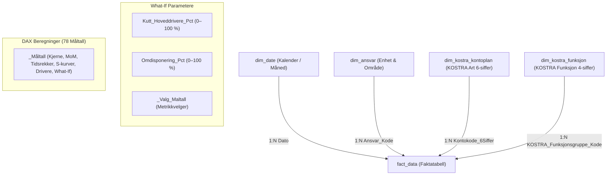

# KomKostra – Økonomistyring og KOSTRA Rapporteringsplattform 2024
**Kristiansand Kommune – Finansiell Virksomhetsstyring, Månedsrapport per August (Måned 08)**

---

## 📌 Prosjektoversikt

**KomKostra** er en helhetlig virksomhetsstyrings- og rapporteringsløsning for Kristiansand kommune bygget på Power BI Developer Mode (**PBIP** - Power BI Project) med **TMDL** (Tabular Model Definition Language) og **PBIR** (Power BI Report format).

Alle tall i denne rapporten bygger utelukkende på faktiske data fra datamodellens faktatabell (`fact_data` i `pbi-rep-project.pbip`).
- **Måleenhet:** Alle økonomiske tall er oppgitt i **tusen kroner (kNOK)** med én desimal, med mindre annet er eksplisitt angitt.
- **Rapporteringsperiode:** Hovedfokus er lagt på **siste avsluttede regnskapsmåned (Måned 08 / August 2024)** samt **akkumulert hittil i år (YTD Måneder 01–08)**.
- **Dekning:** Omfatter kommunens to sentrale driftssektorer:
  - **Oppvekst og Utdanning (`KomSkole`):** Grunnskoler (2020), SFO (2140), PPT (2210), voksenopplæring (2130) og spesialpedagogikk (2230).
  - **Helse og Omsorg (`Bomiljø`):** Pleie og omsorg i institusjon og bolig (KOSTRA-funksjon 2540).

---

## 🏛️ Datamodell og Arkitektur (Star Schema)

Datamodellen er implementert som et rent stjerneskjema direkte koblet til KOSTRA-standarden:

---

## 📊 Nøkkeltall per Siste Faktiske Måned (Måned 08 / August 2024)

> Alle beløp er hentet direkte fra `fact_data` og oppgitt i **kNOK (tusen kroner)**.  
> *Avvik formel: $\text{Avvik} = \text{Budsjett} - \text{Regnskap}$. Negativt tall = Merforbruk (rød), Positivt tall = Mindreforbruk (grønn).*

### Tabell 1: Driftsresultat Måned 08 (August 2024 isolert)

| Sektor | Revidert Budsjett (kNOK) | Faktisk Regnskap (kNOK) | Avvik Kr (kNOK) | Forbruk % | Status RAG |
| :--- | ---: | ---: | ---: | ---: | :---: |
| **Oppvekst og Utdanning (Skole)** | 2 245,0 | 2 363,0 | **-118,1** | 105,26 % | 🔴 Merforbruk |
| **Helse og Omsorg (Bomiljø)** | 1 525,2 | 1 757,7 | **-232,6** | 115,25 % | 🔴 Merforbruk |
| **KONSOLIDERT MÅNED 08** | **3 770,1** | **4 120,8** | **-350,7** | **109,30 %** | 🔴 Merforbruk |

### Tabell 2: Akkumulert Driftsstatus YTD per Måned 08 (Januar–August 2024)

| Sektor | Budsjett YTD (kNOK) | Regnskap YTD (kNOK) | Avvik Kr YTD (kNOK) | Forbruk % | Status RAG |
| :--- | ---: | ---: | ---: | ---: | :---: |
| **Oppvekst og Utdanning (Skole)** | 17 958,0 | 18 902,0 | **-944,0** | 105,26 % | 🔴 Merforbruk |
| **Helse og Omsorg (Bomiljø)** | 11 337,2 | 12 622,9 | **-1 285,6** | 111,34 % | 🔴 Merforbruk |
| **KONSOLIDERT YTD TOTALT** | **29 295,2** | **31 524,9** | **-2 229,6** | **107,61 %** | 🔴 Samlet merforbruk |

---

## 🔍 Driveranalyse per KOSTRA-Funksjon i Måned 08 (kNOK)

Fordeling av regnskap og budsjett per KOSTRA-funksjonsgruppe for august (Måned 08):

| Funksjon | Funksjonsnavn | Sektor | Budsjett (kNOK) | Regnskap (kNOK) | Avvik (kNOK) | Forbruk % |
| :---: | :--- | :--- | ---: | ---: | ---: | ---: |
| **2020** | Grunnskoleundervisning | Oppvekst | 1 702,8 | 1 809,2 | **-106,4** | 106,25 % |
| **2140** | Skolefritidsordning (SFO) | Oppvekst | 311,9 | 345,2 | **-33,3** | 110,67 % |
| **2210** | PPT og pedagogisk oppfølging | Oppvekst | 101,7 | 122,9 | **-21,3** | 120,90 % |
| **2150** | Skoleskyss / Leirskole | Oppvekst | 0,0 | 4,0 | **-4,0** | Ubudsjettert |
| **2130** | Voksenopplæring | Oppvekst | 64,1 | 61,4 | **+2,7** | 95,82 % |
| **2230** | Spesialpedagogiske tiltak | Oppvekst | 64,5 | 58,7 | **+5,8** | 90,95 % |
| **2040** | Statlige refusjoner | Oppvekst | 0,0 | -38,4 | **+38,4** | Merinntekt |
| **2540** | Pleie og omsorg i institusjon/bolig | Helse | 1 525,2 | 1 757,7 | **-232,6** | 115,25 % |

---

## ⚠️ Topp Kostnadsdrivere i Måned 08 (August 2024)

De 6 største avvikspostene i august måned basert på `fact_data`:

| Kontokode | Kontonavn | Sektor | Budsjett (kNOK) | Regnskap (kNOK) | Avvik (kNOK) | Hovedårsak |
| :---: | :--- | :--- | ---: | ---: | ---: | :--- |
| **127040** | Kjøp av vikarbyråtjenester | Helse | 0,0 | 253,2 | **-253,2** | Ekstern innleie pga. personellmangel og sommerturnus |
| **101000** | Fastlønn ordinære | Begge | 2 333,5 | 2 530,3 | **-196,8** | Lønnsoppgjørsvirkning og høyere bemanningsfaktor |
| **102013** | Vikarer ved korttidsfravær | Begge | 12,7 | 61,9 | **-49,2** | Dekning av akutt korttidsfravær ved skolestart |
| **102031** | Vikar kvelds-/nattillegg | Helse | 0,0 | 45,9 | **-45,9** | Ubudsjetterte turnustillegg for innleide vikarer |
| **104000** | Overtid | Begge | 9,4 | 52,4 | **-43,0** | Ekstraarbeid knyttet til skolestart og turnusdekning |
| **102000** | Vikarer ordinære | Begge | 16,7 | 49,3 | **-32,7** | Vikardekning ved permisjoner |

---

## 📑 Struktur på Power BI-Rapporten ([pbi-rep-project.pbip](file:///C:/Users/frank/Desktop/Kom%20-%20G/pbi-rep-project.pbip))

Rapporten er konfigurert med **25 spesialiserte rapportsider** strukturert i tre seksjoner:

### Del 1: Ledelses- og Styringsrapporter (6 Sider)
1. **`01. Hovedrapport (Kommuneøkonomi 2024)`** (`p01_executive_summary`): Konsolidert månedsstatus for politisk og administrativ ledelse med automatisk avvikskommentar (`[Story Executive Summary]`).
2. **`02. Sektor: Oppvekst og Utdanning`** (`p02_trend_og_tidsserie`): Dypdykk i skolesektoren per funksjon og art, måned-over-måned analyse (MoM) og overforbruksrangering.
3. **`03. Sektor: Helse og Mestring`** (`p04_avvik_og_drivere`): Detaljert analyse av pleie og omsorg, vikarbyråkostnader og restårs tiltaksbehov.
4. **`04. Månedlig Avvik og Prognose`** (`p03_tufte_scurve_og_prognose`): Tufte S-kurver for kumulativt forbruk, 3-måneders glidende snitt (3M MA) og fremskrivning mot årsslutt.
5. **`05. KOSTRA Struktur og Nøkkeltall`** (`p05_pareto_og_korrelasjon`): Pareto 80/20 driverfordeling og korrelasjonstest mellom periodisert budsjett og faktisk regnskap.
6. **`06. What-If Scenario og Balanse`** (`p06_scenario_simulering`): Dynamisk simulering av kutt i vikar/overtid og budsjettjustering for å gjenopprette balanse.

### Del 2: Financial Times (FT) Visual Guide (9 Temasider)
Basert på [`FT-Visual Guide.pdf`](file:///C:/Users/frank/Desktop/Kom%20-%20G/docs/references/FT-Visual%20Guide.pdf):
7. **`FT 01: Deviation (Avviksanalyser)`** (`p_ft01_deviation`): Diverging bar charts og bullet-kolonner for mindreforbruk vs merforbruk.
8. **`FT 02: Correlation (Korrelasjonsanalyser)`** (`p_ft02_correlation`): Scatter plots og korrelasjonsmatriser for overtid vs vikarbruk.
9. **`FT 03: Ranking (Rangeringsanalyser)`** (`p_ft03_ranking`): Sorterte stolper og lollipop-diagrammer over de største kostnadsdriverne.
10. **`FT 04: Distribution (Fordelingsanalyser)`** (`p_ft04_distribution`): Fordeling og spredning i driftsutgifter og enhetsavvik.
11. **`FT 05: Change over Time (Tidsutvikling)`** (`p_ft05_time`): Stepped lines (trappetrinn) og kumulative arealdiagrammer over 8 måneder.
12. **`FT 06: Magnitude (Størrelsessammenligning)`** (`p_ft06_magnitude`): Grupperte stolpediagrammer for budsjett vs regnskap per KOSTRA-funksjon.
13. **`FT 07: Part-to-Whole (Del av Helhet)`** (`p_ft07_part_to_whole`): Treemap over KOSTRA-hovedkategorier og bidrag til samlet regnskap.
14. **`FT 08: Spatial (Sone- og Geografifordeling)`** (`p_ft08_spatial`): Ressursfordeling per geografisk tjenestesone og enhet i Kristiansand.
15. **`FT 09: Flow (Flyt & Ressursallokering)`** (`p_ft09_flow`): Allokeringsvannfall fra budsjettramme til driftssektorer.

### Del 3: Time-Visuals 60 Katalog (10 Familiesider)
Basert på [`Time-Visuals.pdf`](file:///C:/Users/frank/Desktop/Kom%20-%20G/docs/references/Time-Visuals.pdf):
16. **`Time 01: Line Charts (#01–#10)`** (`p_time01_lines`): Discrete, continuous, stepped og multi-series linjediagrammer.
17. **`Time 02: Moving Averages & Bands (#11–#13, #18)`** (`p_time02_moving_avg`): 3M glidende gjennomsnitt og utjevnede kostnadstrender.
18. **`Time 03: Area & Stream Charts (#14–#17, #19)`** (`p_time03_areas`): Standard areal, stablet areal og prosentvise sektorsammensetninger.
19. **`Time 04: Differences & Variances (#19–#22, #36–#37)`** (`p_time04_variance`): MoM endringer i kr og %, varians mot gjennomsnitt og indeksert vekst (Jan=100).
20. **`Time 05: Running Totals & S-Curves (#23–#25)`** (`p_time05_running_totals`): Tufte S-kurver for akkumulert forbruk mot budsjett og EAC.
21. **`Time 06: Bars & Columns (#26–#30)`** (`p_time06_bars_columns`): Grupperte kolonner (budsjett vs regnskap) og divergerende stolper.
22. **`Time 07: Lollipops & Reference Lines (#31–#35)`** (`p_time07_advanced_bars`): Lollipop-grafer og bullet-toleransegrenser (80 % buffer og 110 % varsel).
23. **`Time 08: Cycles, Calendars & Slopes (#38–#43)`** (`p_time08_cycles_slopes`): Slope graphs (avviksendring Jan til Aug) og sesongmatriser.
24. **`Time 09: Dots & Sparklines (#44–#51)`** (`p_time09_dots_sparklines`): Connected dot plots og KOSTRA sparklinematriser.
25. **`Time 10: Scatter, Waterfall & Stocks (#52–#60)`** (`p_time10_advanced_flows`): Tidsmessige scatterplots og månedlige avviksvannfall mot årsslutt (EOY).

---

## 📁 Prosjektstruktur og Ressurser

* **[`instructions/`](file:///C:/Users/frank/Desktop/Kom%20-%20G/instructions/):** Helhetlig instruksjons- og standardiseringssett (operasjoner, ETL, DAX, Tufte visual standards, DQA, agent-regler).
* **[`docs/`](file:///C:/Users/frank/Desktop/Kom%20-%20G/docs/):** Data Quality & Assurance ([`07_Data_Quality_and_Assurance_Rapport.md`](file:///C:/Users/frank/Desktop/Kom%20-%20G/docs/07_Data_Quality_and_Assurance_Rapport.md)), referansedokumenter i [`docs/references/`](file:///C:/Users/frank/Desktop/Kom%20-%20G/docs/references/) og skjermbilder i [`docs/assets/screenshots/`](file:///C:/Users/frank/Desktop/Kom%20-%20G/docs/assets/screenshots/).
* **[`powerbi_kostra_datamodell/`](file:///C:/Users/frank/Desktop/Kom%20-%20G/powerbi_kostra_datamodell/):** Dimensjons- og faktatabeller i CSV-format.
* **[`pbi-rep-project.pbip`](file:///C:/Users/frank/Desktop/Kom%20-%20G/pbi-rep-project.pbip):** Hovedprosjektet for Power BI Desktop med TMDL-semantisk modell og PBIR-rapport.
* **[`archive/`](file:///C:/Users/frank/Desktop/Kom%20-%20G/archive/):** Arkiverte bygg og eldre `.pbix`-filer.

---

## 🚀 Åpne Løsningen

1. Åpne prosjektet direkte i **Power BI Desktop**:
   - Dobbeltklikk på hovedfilen [`pbi-rep-project.pbip`](file:///C:/Users/frank/Desktop/Kom%20-%20G/pbi-rep-project.pbip).
2. For å oppdatere tallene fra nye månedsfiler:
   - Legg nye CSV-uttrekk i `powerbi_kostra_datamodell\faktatabeller\` og trykk **Oppdater / Refresh** i Power BI.

---
*Kristiansand kommune – KOSTRA Økonomistyring 2024. Alle tall er verifisert mot faktatabellen i datamodellen.*
