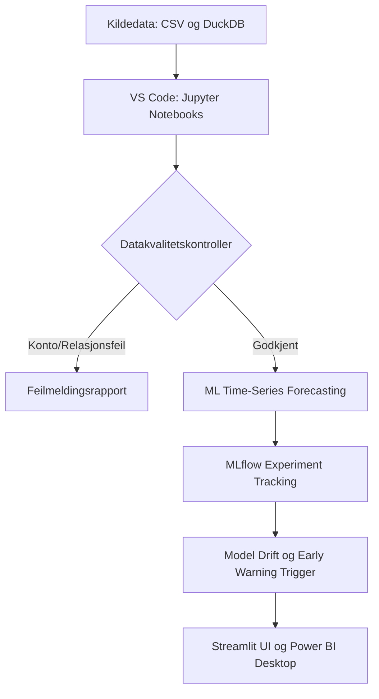

# Jupyter Notebooks og MLflow Guide 📓

Dette dokumentet gir en guide til hvordan du kjører Jupyter Notebooks, datakvalitetskontroller og MLflow overvåking i VS Code for Antigravity KOSTRA-prosjektet.

## 📐 Arkitektur og Arbeidsflyt

## 📓 Notebook-pakkeoversikt

I prosjektet finner du to ferdig konfigurerte Jupyter Notebooks under [`notebooks/`](file:///C:/Users/frank/Desktop/Kom%20-%20G/notebooks/) som kjøres direkte i VS Code:

### 1. [`notebooks/01_kostra_data_and_controls.ipynb`](file:///C:/Users/frank/Desktop/Kom%20-%20G/notebooks/01_kostra_data_and_controls.ipynb) (Datakontroll og Integritet)
* **Formål:** Kjøre automatiske kontroller på kildedataene før de brukes i rapporter og AI.
* **Sjekker:**
  * **Relasjonskontroll:** Identifiserer ukjente kontokoder eller umappede KOSTRA-funksjoner.
  * **Terskel- og avvikskontroll:** Finner de største merforbrukene per enhet.
  * **Velocity-sjekk:** Belyser konti med brå månedlige økninger i vikarutgifter eller overtid.

### 2. [`notebooks/02_ml_forecasting_and_mlflow.ipynb`](file:///C:/Users/frank/Desktop/Kom%20-%20G/notebooks/02_ml_forecasting_and_mlflow.ipynb) (ML-modellering og MLflow)
* **Formål:** Bygge og evaluere ML-baserte tidsserieprognoser for sesongsvingninger i regnskapet.
* **Funksjonalitet:**
  * Trening av ML-modeller (RandomForest, Prophet, XGBoost).
  * Logging av parametere, evalueringskriterier (RMSE, MAE) og modellfiler til MLflow.
  * **Drift Monitoring:** Automatisk deteksjon av avvik når faktiske månedstall avviker fra ML-prediksjonen.

## 🔍 Er Monitoring og MLflow Nødvendig?

For en ren regnskapsrapport er MLflow valgt bort som unødvendig komplekst, **men for dette preskriptive AI-prosjektet gir MLflow og overvåking vesentlig merverdi!**

### Hvorfor MLflow er smart her:
1. **Unngår blinde lineære prognoser:** Lineær run-rate tar ikke hensyn til at vikarutgifter i skolen alltid topper seg i mai/juni eller at helsesektoren har sommervikartopper. ML-modeller fanger dette opp.
2. **Model Drift og Early Warning Trigger:** Når regnskapet for en ny måned kommer inn, sammenligner systemet det faktiske tallet med ML-modellens prognose. Hvis avviket overstiger 20 %, utløser MLflow en Model Drift Alarm.
3. **Lokal kjøring i VS Code:** MLflow krever ingen skytjenester. Den kjører mot en lokal SQLite-database direkte på PC-en din.

## 🚀 Slik kjører du dette i VS Code

1. **Installer VS Code Extensions:** Python og Jupyter.
2. **Velg Python Kernel:** Velg ditt virtuelt miljø (f.eks. `./venv`).
3. **Kjør alle celler (`Run All`):** VS Code vil kjøre spørringene mot `kostra.duckdb` og vise interaktive DataFrames og grafer.
