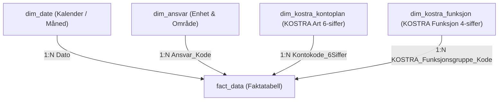

# 📐 02: Datamodell- og ETL-Standarder

Dette dokumentet definerer kravene til stjerneskjemaarkitektur, Power Query M-transformasjoner og dimensjonshåndtering i **KomKostra**.

---

## 1. Stjerneskjema Arkitektur (Star Schema)

Datamodellen skal utelukkende bygges som et rent stjerneskjema i overensstemmelse med Kimball-metodikk og Power BI Best Practice:



### Modellregler:
1. **Énveisrelasjoner (Single Direction):** Alle relasjoner fra dimensjoner til `fact_data` skal være `1:N` med enkeltrettet filterretning (*1 to Many, Single Direction*). Unngå toveisrelasjoner (*Bi-directional filtering*).
2. **Ingen Snøflak (Snowflaking):** Hierarkier (som Tjenesteområde -> Hovedfunksjon -> Funksjonsgruppe) er denormalisert direkte inn i `dim_kostra_funksjon.csv`.
3. **Ingen Kalkulerte Kolonner i Faktatabellen:** All forretningslogikk skal implementeres som DAX-måltall i tabellen `_Måltall`.

---

## 2. Power Query Ingestion (Folder Import)

### A. Dynamisk Faktakonsolidering
Faktadata hentes via Power Query funksjonen `Folder.Files`:
```powerquery
Source = Folder.Files("C:\Users\frank\Desktop\Kom - G\powerbi_kostra_datamodell\faktatabeller")
```
* Filene filtreres automatisk mot skjulte filer (`Attributes[Hidden] <> true`).
* M-skriptet ekstraherer `Source.Name` for å bevare full sporbarhet til opprinnelig CSV-fil.
* Nye måneder konsolideres automatisk uten at kildekoden må endres.

### B. Datatyper og Nøkkelhåndtering
Alle dimensjonsnøkler transformeres eksplisitt til **Tekst (String)** for å sikre eksakt kobling og unngå at ledende nuller fjernes:
* `KOSTRA_Funksjonsgruppe_Kode` -> `type text`
* `Kontokode_6Siffer` -> `type text`
* `Ansvar_Kode` -> `type text`
* `Budsjett` og `Regnskap` -> `Int64.Type` (eller `Currency`/`Decimal`)

---

## 3. Håndtering av Foreldreløse Nøkler (Orphan Keys)

Dersom det dukker opp nye ansvarssteder eller kontoer i `fact_data` som ikke eksisterer i dimensjonstabellene:
1. Power BI vil automatisk legge til en tom rad i dimensjonen (*Blank* rad i visualer).
2. Dette avdekkes umiddelbart på DQA-siden via målet `[QA Umappede Kontokoder Antall]`.
3. **Korrigerende tiltak:** Oppdater den respektive CSV-filen i `powerbi_kostra_datamodell/dimensjoner/` med den nye koden og navnet, og trykk *Oppdater*.

---

## 4. Lokal SQL-Analyse (DuckDB & SQLite)

For rask avstemming eller analyse utenfor Power BI anbefales det å benytte **DuckDB** direkte mot CSV-filene:
```sql
-- Hurtigavstemming per sektor for Måned 08 i DuckDB:
SELECT 
    Sektor,
    ROUND(SUM(Budsjett) / 1000.0, 1) AS Budsjett_kNOK,
    ROUND(SUM(Regnskap) / 1000.0, 1) AS Regnskap_kNOK,
    ROUND((SUM(Budsjett) - SUM(Regnskap)) / 1000.0, 1) AS Avvik_kNOK
FROM 'powerbi_kostra_datamodell/faktatabeller/*.csv'
WHERE Dato = '2024-08-01'
GROUP BY Sektor;
```
Dette gir øyeblikkelig verifikasjon av rådata før publisering i Power BI.
